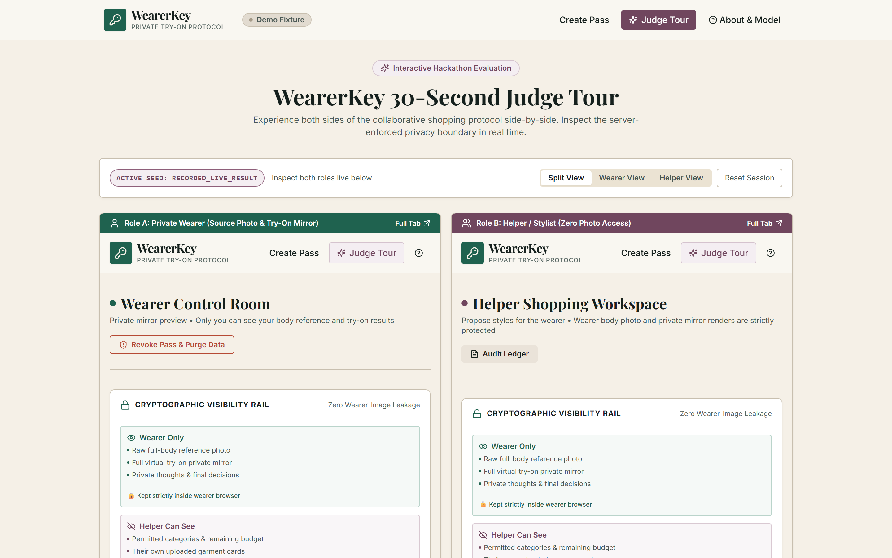
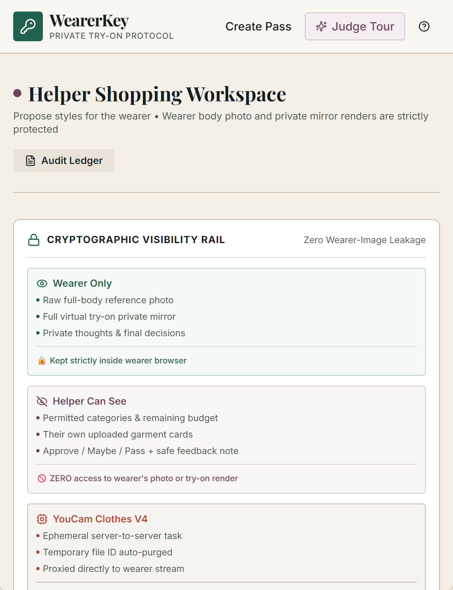
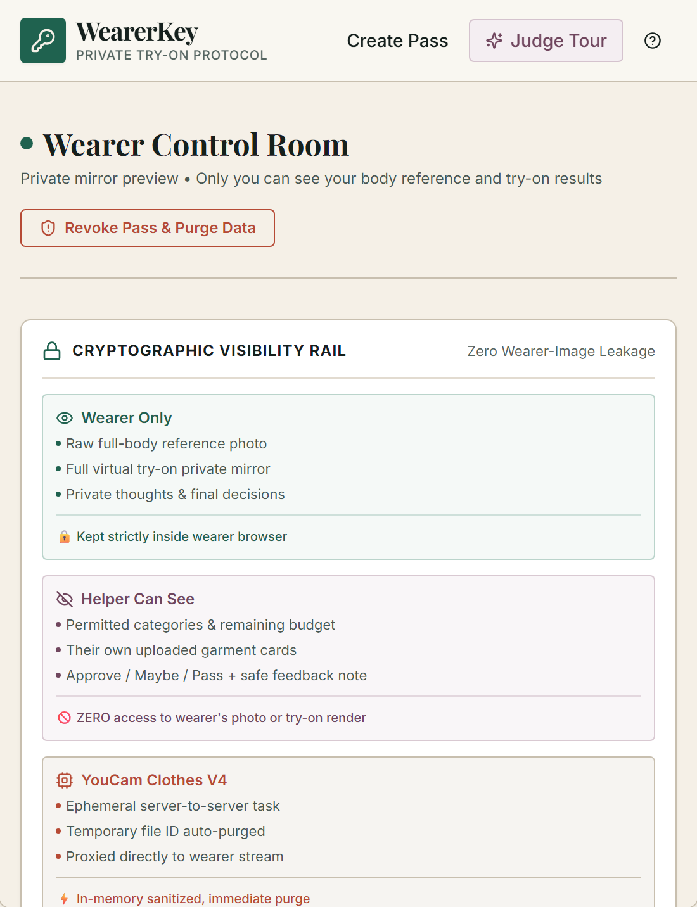
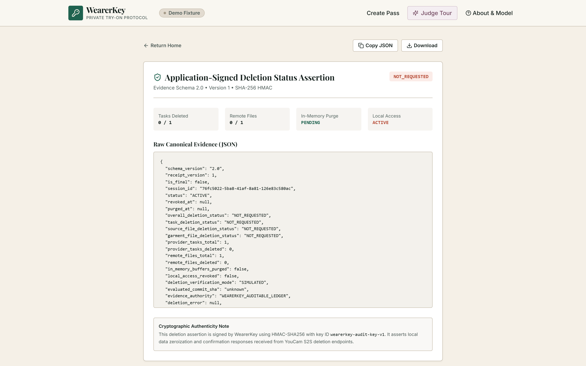

# WearerKey — Private Collaborative Virtual Try-On

[](https://github.com/abhijeetnardele24-hash/youcam-wearerkey/actions)
[](LICENSE)
[](https://www.perfectcorp.com)

> **Shop together without sharing the wearer's photo.**  
> An evidence-backed privacy protocol orchestrating Perfect Corp's **YouCam AI Clothes V4** API for collaborative fashion curation without surrendering personal reference images.

---

## 1. Executive Summary & Problem Thesis

Collaborative shopping is one of the most natural social behaviors in fashion: shoppers ask partners, friends, or stylists for advice before purchasing. However, contemporary virtual try-on (VTO) tools force an uncomfortable trade-off: **to get feedback on how clothes fit you, you must send your full-body photo or screenshots of yourself to another person.**

For millions of people, this is a privacy barrier due to body sensitivity, personal boundaries, religious practices, or workplace confidentiality.

**WearerKey solves this with a role-separated private collaboration protocol:**
1. **The Wearer** defines an immutable **Consent Seal** (permitted garment categories, candidate cap, expiration) and uploads their private reference photo.
2. **The Wearer** shares a cryptographically scoped **Helper Link** with a shopping companion.
3. **The Helper** proposes garments from online stores matching the allowed categories, but **NEVER sees or receives the wearer's photo or try-on render.**
4. **The Server** orchestrates YouCam's official **AI Clothes V4 API** (`/s2s/v2.0/task/cloth-v4`) asynchronously, sanitizing metadata in-memory via Sharp and relaying the visual result **strictly into the Wearer's Private Mirror**.
5. **The Wearer** casts a standardized verdict (**Approve / Maybe / Pass**) with an optional safe note, giving the helper the exact styling signal they need without exposing personal pixels.

---

## 2. Architecture & The Server-Enforced Privacy Boundary


### Trust Boundaries & Safeguards
- **Server-Enforced Role Separation:** Tested helper routes expose no wearer or result image bytes; helper route handlers (`/api/helper/*`) completely omit wearer photos and try-on stream URLs from all response DTOs.
- **Server-Side In-Memory Sanitization:** EXIF/GPS sanitization occurs server-side in memory before provider transmission. Before sending images to YouCam's File API, GPS coordinates, device tags, and camera metadata are stripped in memory via Sharp.
- **Capability Tokens:** Role authorization is governed by cryptographically random 32-byte capability tokens stored solely as SHA-256 hashes and compared in constant time (`crypto.timingSafeEqual`).
- **Encrypted Provider Identifiers:** Remote task IDs and ephemeral provider URLs are encrypted at rest using AES-256-GCM.
- **Provider Deletion Lifecycle:** WearerKey issues explicit deletion requests (`DELETE /s2s/v2.0/file/{fileId}` and `POST /s2s/v2.0/task/delete`) upon session completion or revocation, producing an HMAC-SHA256 signed audit receipt v2.0. The HMAC signature proves the authenticity and integrity of the application-issued receipt ledger; deletion confirmation reflects the recorded responses from the provider API.
- **Accessibility:** 0 Axe-core violations across tested states and viewports (Home, Create, Judge Tour, Wearer Room, Helper Room).

---

## 3. Potential Impact & User Model

### Target User Segments
- **Privacy-Conscious Shoppers:** Everyday fashion consumers who want shopping advice from friends without uploading vulnerable body selfies to unencrypted messaging threads.
- **Shoppers with Body-Image Sensitivity:** Consumers who experience anxiety around physical appearance and body scrutiny during collaborative shopping.
- **Modest-Fashion Customers:** Communities with cultural, ethical, or religious privacy norms regarding bodily modesty.
- **Remote Personal Stylists:** Professional fashion advisors and clienteling teams seeking a privacy-preserving protocol to style clients without taking custody of private client photographs.
- **Friends & Family Assisting Purchases:** Gift-givers, partners, and family members collaborating on wardrobe curation.

### Retail Value Hypothesis
- **Reduced Abandonment:** Lowers drop-off at the consideration stage when shoppers desire feedback but resist sharing raw body photos.
- **Higher Collaborative Confidence:** Facilitates decisive purchases through private feedback loops (Approve / Maybe / Pass) without friction.
- **Fewer Uncontrolled Copies:** Prevents raw personal photographs from leaking into group chats, phone camera rolls, and third-party cloud photo caches.

---

## 4. Product Screenshots & User Journey

| 1. Interactive Judge Split-Screen (`/judge`) | 2. Server-Enforced Helper Boundary |
| :---: | :---: |
|  |  |
| *Simultaneous wearer mirror and helper curation views.* | *Zero wearer pixels exposed; helper sees metadata only.* |

| 3. Private Wearer Mirror (`/wearer`) | 4. Tamper-Evident Deletion Receipt (`/receipt`) |
| :---: | :---: |
|  |  |
| *3-Stage comparison: reference, candidate, and YouCam render.* | *HMAC-SHA256 ledger proving provider deletion responses.* |

---

## 5. 30-Second Judge Tour

We built an interactive, pre-seeded evaluation suite that allows hackathon judges to test both roles side-by-side in under 30 seconds with 1 click:

1. Start the server (or open the local deployment at `http://localhost:3000`).
2. Navigate to **`/judge`**.
3. Click **"Launch Interactive Split-Screen"**.
4. Observe the **Wearer Control Room** on the left (showing the full private mirror and decision slip) alongside the **Helper Workspace** on the right (showing permitted categories and proposal tools with **zero wearer images**).
5. Open browser Developer Tools (`Network` tab) on the Helper pane to verify that zero wearer image requests or payloads are ever sent to the helper.
6. Inspect the **Judge Evidence Panel** to observe active provider mode, Sharp in-memory sanitization status, and HMAC-SHA256 receipt integrity.

---

## 6. YouCam AI Clothes V4 Engine Integration

WearerKey integrates with Perfect Corp's official YouCam Clothes V4 Server-to-Server API:
- **Base Endpoint:** `https://yce-api-01.makeupar.com` (India region)
- **File Upload:** `POST /s2s/v2.0/file` (uploads reference and candidate garments, receives ephemeral file IDs).
- **Task Dispatch:** `POST /s2s/v2.0/task/cloth-v4` (executes virtual garment drape across supported categories: `upper_body`, `lower_body`, `full_body`, `outer`, `shoes`, `auto`).
- **Asynchronous Polling:** `GET /s2s/v2.0/task/cloth-v4/{taskId}` with exponential backoff.
- **Remote Deletion:** `DELETE /s2s/v2.0/file/{fileId}` and `POST /s2s/v2.0/task/delete` upon completion.
- **Fail-Closed Provider Modes:**
  - `LIVE_YOUCAM`: Active when valid `YOUCAM_API_KEY` is present.
  - `RECORDED_LIVE_RESULT`: Transparent replay of genuine YouCam test fixtures when key is unconfigured.
  - `DEMO_FIXTURE`: Deterministic offline evaluation mode.

Verified connectivity receipt is tracked in [`docs/live-youcam-receipt.json`](docs/live-youcam-receipt.json).

---

## 7. Quickstart & Local Development

### Prerequisites
- Node.js v20+ or v24+
- `pnpm` v9+ or v12+

### Installation & Run

```bash
# Clone the repository
git clone https://github.com/abhijeetnardele24-hash/youcam-wearerkey.git
cd youcam-wearerkey

# Install dependencies across all workspaces
pnpm install

# Copy environment template
cp .env.example .env

# Run master verification suite (unit tests, integration tests, web build, security scan, claims check)
pnpm run verify

# Mode A: Development Mode (Vite on port 3000 proxying /api to Fastify on port 4000)
pnpm dev

# Mode B: Production / Standalone Mode (Unified Fastify server on port 3000 serving API + built SPA)
pnpm build
pnpm start
```

Visit `http://localhost:3000` in your browser.

---

## 8. Environment Variables

| Variable | Required | Default | Description |
| :--- | :---: | :--- | :--- |
| `PORT` | No | `3000` | Port for the unified Fastify server |
| `HOST` | No | `0.0.0.0` | Network binding interface |
| `APP_BASE_URL` | No | `http://localhost:3000` | Base URL used for minted helper invitation links |
| `YOUCAM_BASE_URL` | No | `https://yce-api-01.makeupar.com` | Official YouCam S2S API endpoint |
| `YOUCAM_API_KEY` | Optional | `""` | User-provided YouCam API key for live generation |
| `YOUCAM_PROVIDER_MODE` | No | `DEMO_FIXTURE` | `LIVE_YOUCAM`, `RECORDED_LIVE_RESULT`, or `DEMO_FIXTURE` |
| `PROVIDER_ID_ENCRYPTION_KEY` | Yes | 64-char hex | AES-256-GCM key encrypting remote task/file IDs at rest |
| `SESSION_COOKIE_SECRET` | Yes | 64-char hex | Fastify cookie signing secret for HttpOnly session cookies |
| `RECEIPT_SIGNING_KEY` | Yes | 64-char hex | HMAC-SHA256 key for signing application deletion receipts |
| `DATABASE_URL` | No | `""` | Optional Postgres connection string (uses embedded PGlite if empty) |

---

## 9. Verification Suite & Reproducible Commands

The repository enforces end-to-end evidence integrity through automated suites:

```bash
# 1. Lint with zero warnings
npx eslint . --max-warnings 0

# 2. TypeScript compilation
pnpm typecheck

# 3. Monorepo production build
pnpm build

# 4. Vitest Unit & Integration Tests (80 tests across 6 suites)
pnpm test

# 5. Playwright E2E Browser & Axe Accessibility Scans (10 journeys across Desktop & Mobile 390px)
pnpm test:e2e

# 6. Security scan across tracked files and complete Git commit history
npx tsx scripts/security-scan.ts

# 7. Claims and documentation auditor
npx tsx scripts/check-claims.ts --strict-sha

# 8. Deployment smoke probe
npx tsx scripts/deploy-smoke.ts http://localhost:3000
```

---

## 10. Known Limitations & Responsible-Use Disclosures

- **Visual Appearance Preview Only:** WearerKey simulates clothing drape and aesthetic coordination using YouCam AI Clothes V4. It is an aesthetic decision aid, not a certified sizing, tailoring, stretch, or physical fabric guarantee.
- **Application Ledger Authenticity:** The HMAC-SHA256 signature guarantees application ledger integrity and proves recorded provider HTTP responses. It is not cryptographic proof of external physical deletion on third-party provider infrastructure.
- **Fail-Closed Provider Gate:** In the absence of a verified live `YOUCAM_API_KEY`, the application operates in transparent `DEMO_FIXTURE` or `RECORDED_LIVE_RESULT` mode with zero fabricated claims.

---

## 11. Monorepo Structure

```text
youcam-wearerkey/
├── apps/
│   ├── api/                     # Fastify backend, capability auth, YouCam adapter, PGlite DB
│   │   ├── src/db/              # Drizzle schema (sessions, proposals, tasks, receipts)
│   │   ├── src/providers/youcam # YouCam Clothes V4 live, recorded, and fake providers
│   │   ├── src/routes/          # Role-isolated route handlers (wearer, helper, sessions, judge)
│   │   └── src/services/        # Sharp in-memory sanitizer, SSE event bus
│   └── web/                     # React 18 + Vite + Tailwind frontend ("fitting-room" palette)
│       ├── src/components/      # VisibilityRail, ConsentSeal, PrivateMirror, DecisionSlip
│       └── src/pages/           # HomePage, CreatePassPage, WearerRoom, HelperRoom, JudgeTour
├── packages/
│   ├── contracts/               # Zod schemas, DTOs, and TypeScript contract types
│   └── domain/                  # Capability tokens, state machines, Consent Gate, crypto
├── docs/                        # Complete documentation, receipts, and SVG assets
│   ├── assets/                  # Architecture diagrams & 1280x720 Devpost thumbnail
│   ├── ARCHITECTURE.md          # In-depth architectural blueprint & trust boundaries
│   ├── PRIVACY_MODEL.md         # Role-separated threat model & authorization invariants
│   ├── YOUCAM_INTEGRATION.md    # Detailed Perfect Corp Clothes V4 API specification
│   ├── DEVPOST_SUBMISSION.md    # Complete Devpost submission package
│   ├── FINAL_VIDEO_SOURCE_PACKAGE.md # Timed 2:30 video recording specification
│   ├── JUDGE_TOUR.md            # Evaluator 30-second walkthrough guide
│   ├── THREAT_MODEL.md          # Comprehensive security threat analysis & mitigations
│   ├── EVALUATION.md            # Full verification report, benchmarks & test ledger
│   ├── VIDEO_STORYBOARD.md      # Timed script & visual storyboard for demo video
│   ├── SUBMISSION_CHECKLIST.md  # Official checklist with truthful auditor verdict
│   ├── evidence-index.json      # Structured machine-readable compliance index
│   ├── deployment-receipt.json  # Port setup and deployment verification receipt
│   └── live-youcam-receipt.json # Truthful machine-verifiable connectivity receipt
├── scripts/                     # Master verifier, live smoke, deploy smoke, security scanner
└── tests/                       # Unit tests, integration tests & Playwright e2e/axe tests
```

---

## 12. License

WearerKey is open-source software licensed under the [MIT License](LICENSE).
